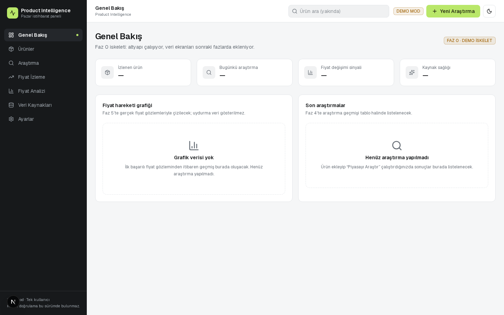
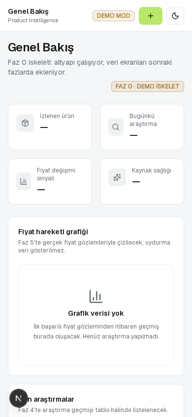
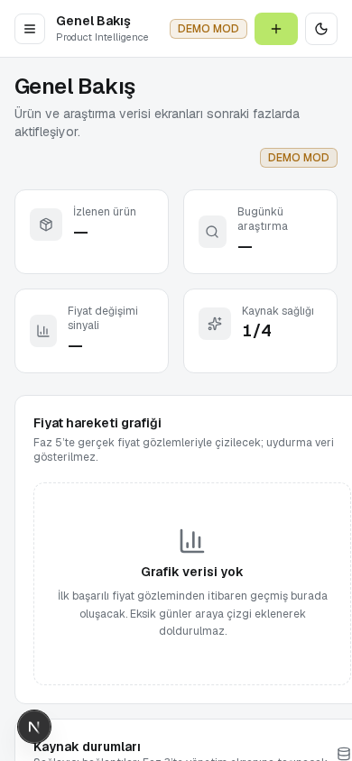

# Product Intelligence

Ürün araştırma, rakip fiyat takibi ve satış fiyatı karar destek sistemi.
Satıcılar aynı ürünün farklı mağazalardaki tekliflerini bulmak, birebir aynısını
muadillerden ayırmak, fiyat/stok hareketlerini izlemek ve kendi maliyetlerine
göre açıklanabilir satış fiyatı önerileri üretmek için bu paneli kullanır.

> Proje, faz faz geliştirilen bir ZCode geliştirme kiti üzerine kuruludur:
> kapsam ve kurallar `docs/`, faz talimatları `prompts/`, uzmanlık dosyaları
> `.agents/skills/` altındadır. Ürün ilkeleri için `AGENTS.md` esas alınır.

## Teknoloji

| Alan | Tercih |
| --- | --- |
| UI + server | Next.js 15 App Router + TypeScript (strict) |
| UI | Tailwind CSS 4 + shadcn tarzı bileşenler + Lucide |
| Veritabanı | PostgreSQL (Drizzle ORM ile) |
| Test | Vitest (birim + entegrasyon), Playwright (E2E) |
| Şema doğrulama | Zod |
| Para matematiği | Decimal.js (Faz 6'dan itibaren) |

## Hızlı başlangıç

### Seçenek A — Docker ile gerçek PostgreSQL (önerilen)

```bash
docker compose up -d
cp .env.example .env
npm install
npm run db:migrate
npm run db:seed
npm run dev
```

### Seçenek B — Docker'sız gömülü PostgreSQL (pglite)

Docker'ın bulunmadığı ortamlar ve testler için `DB_DRIVER=pglite` kullanılır.
pglite, in-process çalışan gerçek bir PostgreSQL'dir (WASM); **yalnızca
geliştirme/test içindir, üretimde PostgreSQL kullanılır.**

```bash
cp .env.example .env
# .env içinde: DB_DRIVER=pglite
npm install
npm run db:migrate
npm run db:seed
npm run dev
```

Uygulama `http://localhost:3000` adresinde açılır. API anahtarı olmadan
DemoProvider ile uçtan uca çalışır; demo verileri her ekranda `DEMO` etiketiyle
işaretlenir.

## Komutlar

| Komut | Açıklama |
| --- | --- |
| `npm run dev` | Geliştirme sunucusu |
| `npm run build` / `npm start` | Production build / sunucu |
| `npm run lint` | ESLint |
| `npm run typecheck` | TypeScript strict tip kontrolü |
| `npm test` | Tüm birim + entegrasyon testleri (Vitest) |
| `npm run test:e2e` | Playwright E2E testleri |
| `npm run db:generate` | Drizzle migration üret |
| `npm run db:migrate` | Migration uygula (postgres veya pglite) |
| `npm run db:seed` | Default workspace seed (idempotent) |

## Geliştirme fazları

| Faz | Kapsam | Durum |
| --- | --- | --- |
| 0 | Repository bootstrap, PostgreSQL, app shell | ✅ Tamamlandı |
| 1 | Premium monochrome UI shell | ✅ Tamamlandı |
| 2 | Ürün kataloğu ve maliyet girdileri | ⏳ Sırada |
| 3 | Provider katmanı + DemoProvider | ⏳ Sırada |
| 4 | Araştırma orkestrasyonu + eşleştirme | ⏳ Sırada |
| 5 | Fiyat geçmişi ve stok gözlemleri | ⏳ Sırada |
| 6 | Fiyatlandırma öneri motoru | ⏳ Sırada |
| 7 | İzleme, zamanlanmış işler, uyarılar | ⏳ Sırada |
| 8 | SaaS-ready tenancy ve Vercel hazırlığı | ⏳ Sırada |
| 9 | Hardening ve release candidate | ⏳ Sırada |

---

## FAZ 0 — Repository bootstrap ve mimari iskelet

**Durum:** ✅ Tamamlandı — `prompts/tests/TEST_00_BOOTSTRAP.md` kontrolleri geçti.

### Yapılanlar

- Next.js 15 (App Router) + TypeScript strict proje altyapısı, `src/` klasör
  yapısı mimari dokümanına (`docs/02_ARCHITECTURE.md`) göre kuruldu.
- Tailwind CSS 4 + Monochrome Intelligence tasarım token'ları
  (`docs/06_UI_UX_DESIGN_SYSTEM.md` paleti light/dark), Geist/Geist Mono
  fontları, Lucide ikonları.
- Drizzle ORM + PostgreSQL bağlantı katmanı; **çift sürücü desteği**:
  `DB_DRIVER=postgres` (Docker/gerçek PG) veya `DB_DRIVER=pglite` (gömülü,
  Docker'sız ortamlar ve testler). Migration klasörü her iki sürücüde ortak.
- `workspaces` tablosu + migration + idempotent default workspace seed.
- Zod ile ortam değişkeni doğrulama (`src/lib/env.ts`): hatalar yalnızca alan
  adlarını raporlar, secret değeri asla yazdırılmaz.
- Ortak API yanıt zarfı (`{ data, meta: { requestId, generatedAt, dataMode }, error }`)
  ve `/api/health` ucu: DB erişilemezse güvenli 503 döner, hata detayı sızmaz.
- App shell: sol menü (7 rota), üst bar (arama yer tutucusu, DEMO MOD rozeti,
  "Yeni Araştırma" CTA, tema düğmesi), KPI şeridi yer tutucusu ve boş durum
  kartları. Tüm yer tutucular açıkça "FAZ 0 · DEMO İSKELET" işaretli.
- ESLint + Prettier + Vitest + Playwright altyapısı ve GitHub Actions CI
  (lint → typecheck → test → build → E2E).
- next.config.ts: `serverExternalPackages` ile pglite/pg bundle dışı bırakıldı
  (WASM yükleme hatası giderildi).

### Test sonuçları

```
npm run typecheck   → 0 hata
npm run lint        → 0 hata, 0 uyarı
npm test            → 10 test, 10 geçti (birim + pglite entegrasyon)
npm run build       → 12 rota üretildi, hata yok
npm run test:e2e    → 9 test, 9 geçti (7 rota konsol hatasız + health)
db:seed (2x)        → idempotent: tek default workspace
```

### Ekran görüntüleri

| | |
| --- | --- |
|  |  |
| Dashboard — açık tema (1440×900) | Dashboard — koyu tema (1440×900) |

Mobil görünüm (390×844): 

### Bilinen sınırlar / sonraki faza hazırlık

- Docker bu ortamda bulunmadığı için kabul testinin `compose up` maddesi
  pglite sürücüsüyle doğrulandı; Docker yolu `docker-compose.yml` ve README
  ile belgelendi.
- KPI değerleri bilinçli olarak `—` (veri yok) gösterir; sahte metrik üretilmez.
- Faz 1'de tema düğmesi kalıcılığı, responsive çekmece menü, loading/skeleton
  ve hata durumları tamamlanacak.

---

## FAZ 1 — Premium monochrome UI shell ve gezinme

**Durum:** ✅ Tamamlandı — `prompts/tests/TEST_01_UI_SHELL.md` kontrolleri geçti.

### Yapılanlar

- **Primitif bileşenler:** Button, Badge, Card, Input/Select/Textarea + Field
  (label/hata), Table (tabular-nums, sağa hizalı sayısal hücreler), Tabs ve
  Dialog (Radix, klavye erişilebilir), Tooltip, Skeleton/CardSkeleton,
  EmptyState, ErrorState (role=alert + yeniden dene).
- **Gezinme:** 7 rota aktif; aktif öğe `aria-current="page"` + lime nokta ile
  işaretlenir. 1024px altında hamburger düğmesiyle Radix Dialog çekmece menü.
- **Tema:** light/dark token'ları; tercih localStorage'da tutulur, ilk
  boyamadan önce uygulanan satır içi betikle FOUC engellenir, yenileme
  sonrası korunur (E2E ile doğrulanır).
- **Dashboard:** KPI şeridi (sahte metrik yok: `—` veya gerçek kaynak sayısı
  1/4), fiyat hareketi yer tutucusu (boş durum açıklamalı), kaynak durum
  paneli (DemoProvider hazır; DataForSEO/Keepa/SerpApi kurulmadı), son
  araştırmalar tablosu — tüm örnek satırlar `ÖRNEK KAYIT` + `DEMO VERİ`
  etiketli, araştırma CTA'sı.
- **Erişilebilirlik:** görünür odak halkası, klavye ile menü gezinme (E2E),
  renk tek başına anlam taşımaz (badge metin + ikon), reduced-motion desteği.

### Test sonuçları

```
npm run typecheck   → 0 hata
npm run lint        → 0 hata, 0 uyarı
npm test            → 17 test, 17 geçti (4 dosya; birim + entegrasyon + bileşen)
npm run build       → başarılı
npm run test:e2e    → 14 test, 14 geçti (tema kalıcılığı, mobil çekmece,
                      klavye odağı, aria-current, DEMO etiketleri, 7 rota)
```

### Ekran görüntüleri

| | |
| --- | --- |
|  |  |
| Dashboard açık tema — KPI şeridi, kaynak durumları, DEMO tablo | Dashboard koyu tema |

Mobil (390×844, tam sayfa): 

### Bilinen sınırlar / sonraki faza hazırlık

- Global arama alanı yer tutucudur; Faz 2'de ürün listesine bağlanacak.
- "Yeni Araştırma" düğmesi henüz pasif; Faz 4'te araştırma akışını başlatacak.
- Sonraki faz: ürün kataloğu (products + pricing_profiles şeması, CRUD API,
  CSV içe aktarma).

