# Product Intelligence

Ürün araştırma, rakip fiyat takibi ve satış fiyatı karar destek sistemi.
Satıcılar aynı ürünün farklı mağazalardaki tekliflerini bulmak, birebir aynısını
muadillerden ayırmak, fiyat/stok hareketlerini izlemek ve kendi maliyetlerine
göre açıklanabilir satış fiyatı önerileri üretmek için bu paneli kullanır.

> Proje, faz faz geliştirilen bir ZCode geliştirme kiti üzerine kuruludur:
> kapsam ve kurallar `docs/`, faz talimatları `prompts/`, uzmanlık dosyaları
> `.agents/skills/` altındadır. Ürün ilkeleri için `AGENTS.md` esas alınır.

## Teknoloji

| Alan | Tercih |
| --- | --- |
| UI + server | Next.js 15 App Router + TypeScript (strict) |
| UI | Tailwind CSS 4 + shadcn tarzı bileşenler + Lucide |
| Veritabanı | PostgreSQL (Drizzle ORM ile) |
| Test | Vitest (111 test), Playwright (31 E2E) |
| Şema doğrulama | Zod |
| Para matematiği | Decimal.js (Faz 6'dan itibaren) |

## Hızlı başlangıç

### Seçenek A — Docker ile gerçek PostgreSQL (önerilen)

```bash
docker compose up -d
cp .env.example .env
npm install
npm run db:migrate
npm run db:seed
npm run dev
```

### Seçenek B — Docker'sız gömülü PostgreSQL (pglite)

Docker'ın bulunmadığı ortamlar ve testler için `DB_DRIVER=pglite` kullanılır.
pglite, in-process çalışan gerçek bir PostgreSQL'dir (WASM); **yalnızca
geliştirme/test içindir, üretimde PostgreSQL kullanılır.**

```bash
cp .env.example .env
# .env içinde: DB_DRIVER=pglite
npm install
npm run db:migrate
npm run db:seed
npm run dev
```

Uygulama `http://localhost:3000` adresinde açılır. API anahtarı olmadan
DemoProvider ile uçtan uca çalışır; demo verileri her ekranda `DEMO` etiketiyle
işaretlenir.

## Komutlar

| Komut | Açıklama |
| --- | --- |
| `npm run dev` | Geliştirme sunucusu |
| `npm run build` / `npm start` | Production build / sunucu |
| `npm run lint` | ESLint |
| `npm run typecheck` | TypeScript strict tip kontrolü |
| `npm test` | Tüm birim + entegrasyon testleri (Vitest) |
| `npm run test:e2e` | Playwright E2E testleri |
| `npm run db:generate` | Drizzle migration üret |
| `npm run db:migrate` | Migration uygula (postgres veya pglite) |
| `npm run db:seed` | Default workspace seed (idempotent) |

## Geliştirme fazları

| Faz | Kapsam | Durum |
| --- | --- | --- |
| 0 | Repository bootstrap, PostgreSQL, app shell | ✅ Tamamlandı |
| 1 | Premium monochrome UI shell | ✅ Tamamlandı |
| 2 | Ürün kataloğu ve maliyet girdileri | ✅ Tamamlandı |
| 3 | Provider katmanı + DemoProvider | ✅ Tamamlandı |
| 4 | Araştırma orkestrasyonu + eşleştirme | ✅ Tamamlandı |
| 5 | Fiyat geçmişi ve stok gözlemleri | ✅ Tamamlandı |
| 6 | Fiyatlandırma öneri motoru | ✅ Tamamlandı |
| 7 | İzleme, zamanlanmış işler, uyarılar | ✅ Tamamlandı |
| 8 | SaaS-ready tenancy ve Vercel hazırlığı | ✅ Tamamlandı |
| 9 | Hardening ve release candidate | ✅ Tamamlandı |

---

## FAZ 0 — Repository bootstrap ve mimari iskelet

**Durum:** ✅ Tamamlandı — `prompts/tests/TEST_00_BOOTSTRAP.md` kontrolleri geçti.

### Yapılanlar

- Next.js 15 (App Router) + TypeScript strict proje altyapısı, `src/` klasör
  yapısı mimari dokümanına (`docs/02_ARCHITECTURE.md`) göre kuruldu.
- Tailwind CSS 4 + Monochrome Intelligence tasarım token'ları
  (`docs/06_UI_UX_DESIGN_SYSTEM.md` paleti light/dark), Geist/Geist Mono
  fontları, Lucide ikonları.
- Drizzle ORM + PostgreSQL bağlantı katmanı; **çift sürücü desteği**:
  `DB_DRIVER=postgres` (Docker/gerçek PG) veya `DB_DRIVER=pglite` (gömülü,
  Docker'sız ortamlar ve testler). Migration klasörü her iki sürücüde ortak.
- `workspaces` tablosu + migration + idempotent default workspace seed.
- Zod ile ortam değişkeni doğrulama (`src/lib/env.ts`): hatalar yalnızca alan
  adlarını raporlar, secret değeri asla yazdırılmaz.
- Ortak API yanıt zarfı (`{ data, meta: { requestId, generatedAt, dataMode }, error }`)
  ve `/api/health` ucu: DB erişilemezse güvenli 503 döner, hata detayı sızmaz.
- App shell: sol menü (7 rota), üst bar (arama yer tutucusu, DEMO MOD rozeti,
  "Yeni Araştırma" CTA, tema düğmesi), KPI şeridi yer tutucusu ve boş durum
  kartları. Tüm yer tutucular açıkça "FAZ 0 · DEMO İSKELET" işaretli.
- ESLint + Prettier + Vitest + Playwright altyapısı ve GitHub Actions CI
  (lint → typecheck → test → build → E2E).
- next.config.ts: `serverExternalPackages` ile pglite/pg bundle dışı bırakıldı
  (WASM yükleme hatası giderildi).

### Test sonuçları

```
npm run typecheck   → 0 hata
npm run lint        → 0 hata, 0 uyarı
npm test            → 10 test, 10 geçti (birim + pglite entegrasyon)
npm run build       → 12 rota üretildi, hata yok
npm run test:e2e    → 9 test, 9 geçti (7 rota konsol hatasız + health)
db:seed (2x)        → idempotent: tek default workspace
```

### Ekran görüntüleri

| | |
| --- | --- |
|  | 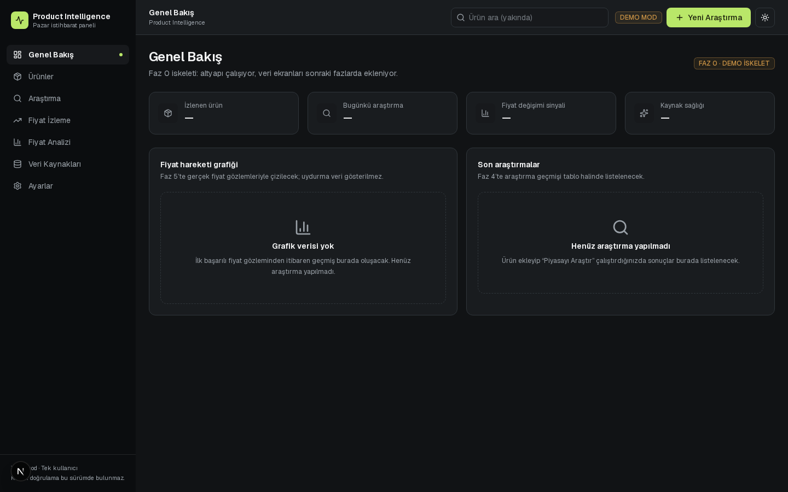 |
| Dashboard — açık tema (1440×900) | Dashboard — koyu tema (1440×900) |

Mobil görünüm (390×844): 

### Bilinen sınırlar / sonraki faza hazırlık

- Docker bu ortamda bulunmadığı için kabul testinin `compose up` maddesi
  pglite sürücüsüyle doğrulandı; Docker yolu `docker-compose.yml` ve README
  ile belgelendi.
- KPI değerleri bilinçli olarak `—` (veri yok) gösterir; sahte metrik üretilmez.
- Faz 1'de tema düğmesi kalıcılığı, responsive çekmece menü, loading/skeleton
  ve hata durumları tamamlanacak.

---

## FAZ 1 — Premium monochrome UI shell ve gezinme

**Durum:** ✅ Tamamlandı — `prompts/tests/TEST_01_UI_SHELL.md` kontrolleri geçti.

### Yapılanlar

- **Primitif bileşenler:** Button, Badge, Card, Input/Select/Textarea + Field
  (label/hata), Table (tabular-nums, sağa hizalı sayısal hücreler), Tabs ve
  Dialog (Radix, klavye erişilebilir), Tooltip, Skeleton/CardSkeleton,
  EmptyState, ErrorState (role=alert + yeniden dene).
- **Gezinme:** 7 rota aktif; aktif öğe `aria-current="page"` + lime nokta ile
  işaretlenir. 1024px altında hamburger düğmesiyle Radix Dialog çekmece menü.
- **Tema:** light/dark token'ları; tercih localStorage'da tutulur, ilk
  boyamadan önce uygulanan satır içi betikle FOUC engellenir, yenileme
  sonrası korunur (E2E ile doğrulanır).
- **Dashboard:** KPI şeridi (sahte metrik yok: `—` veya gerçek kaynak sayısı
  1/4), fiyat hareketi yer tutucusu (boş durum açıklamalı), kaynak durum
  paneli (DemoProvider hazır; DataForSEO/Keepa/SerpApi kurulmadı), son
  araştırmalar tablosu — tüm örnek satırlar `ÖRNEK KAYIT` + `DEMO VERİ`
  etiketli, araştırma CTA'sı.
- **Erişilebilirlik:** görünür odak halkası, klavye ile menü gezinme (E2E),
  renk tek başına anlam taşımaz (badge metin + ikon), reduced-motion desteği.

### Test sonuçları

```
npm run typecheck   → 0 hata
npm run lint        → 0 hata, 0 uyarı
npm test            → 17 test, 17 geçti (4 dosya; birim + entegrasyon + bileşen)
npm run build       → başarılı
npm run test:e2e    → 14 test, 14 geçti (tema kalıcılığı, mobil çekmece,
                      klavye odağı, aria-current, DEMO etiketleri, 7 rota)
```

### Ekran görüntüleri

| | |
| --- | --- |
| 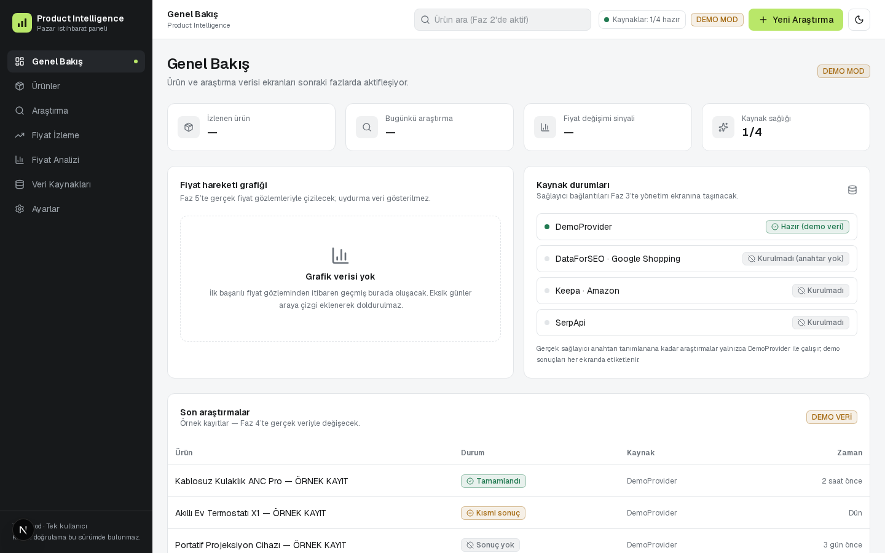 | 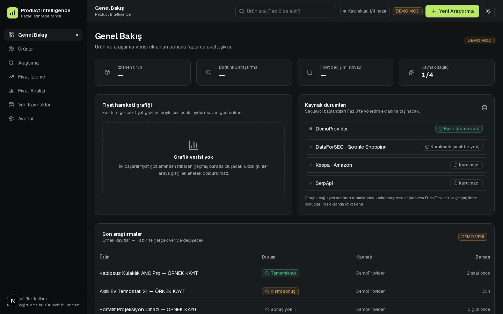 |
| Dashboard açık tema — KPI şeridi, kaynak durumları, DEMO tablo | Dashboard koyu tema |

Mobil (390×844, tam sayfa): 

### Bilinen sınırlar / sonraki faza hazırlık

- Global arama alanı yer tutucudur; Faz 2'de ürün listesine bağlanacak.
- "Yeni Araştırma" düğmesi henüz pasif; Faz 4'te araştırma akışını başlatacak.
- Sonraki faz: ürün kataloğu (products + pricing_profiles şeması, CRUD API,
  CSV içe aktarma).


---

## FAZ 2 — Ürün kataloğu ve maliyet girdileri

**Durum:** ✅ Tamamlandı — `prompts/tests/TEST_02_PRODUCTS_CATALOG.md` kontrolleri geçti.

### Yapılanlar

- **Şema:** `products` (kimlik + maliyet girdileri + özellikler + izleme alanları)
  ve `pricing_profiles` tabloları, workspace FK, `workspace+SKU` unique index,
  GTIN index; migration `drizzle/0001`.
- **GTIN doğrulama:** GS1 kontrol hanesi (GTIN-8/12/13/14), ayraç temizliği,
  14 haneye kanonikleştirme — orijinal değer korunur.
- **Doğrulama (Zod):** Türkçe mesajlar; negatif maliyet, bozuk onluk metin
  ("1.299,90" kabul edilir), hatalı ISO para birimi, https dışı URL reddedilir.
- **Repository/Servis:** tüm sorgular workspace kapsamlı; SKU/GTIN mükerrer
  kontrolü; arşivle/geri yükle (soft delete); liste filtreleri (arama, kategori,
  izleme), sıralama ve sayfalama (maks 100).
- **API:** `GET/POST /api/products`, `GET/PATCH/DELETE /api/products/:id`
  (update|archive|restore eylemleri), `POST /api/products/import`
  (dryRun önizleme / kalıcı içe aktarma) — ortak zarf + request id.
- **CSV içe aktarma:** TR/EN başlık takma adları, önizlemede satır bazlı hata
  raporu, yalnızca geçerli satırlar kaydedilir; 500 satır / 512 KB limiti;
  formül enjeksiyonu nötralizasyonu dışa aktarım için hazır (`neutralizeCsvCell`).
- **Arayüz:** ürün listesi (filtre/sıralama/sayfalama + arşiv görünümü),
  ürün ekle/düzenle formu (alan bazlı hata gösterimi), ürün detay
  (bilgiler + maliyet özeti), CSV içe aktarma sihirbazı; örnek ürün seed'i
  (`npm run db:seed` ile idempotent).

### Test sonuçları

```
npm run typecheck   → 0 hata
npm run lint        → 0 hata, 0 uyarı
npm test            → 41 test, 41 geçti (GTIN, doğrulama, CSV, workspace izolasyonu,
                      CRUD yaşam döngüsü, CSV içe aktarma — pglite üzerinde)
npm run build       → 13 rota, başarılı
npm run test:e2e    → 18 test, 18 geçti (ürün oluşturma → arşiv akışı,
                      CSV önizleme/içe aktarma, doğrulama hataları, mobil form)
```

### Ekran görüntüleri

| | |
| --- | --- |
| 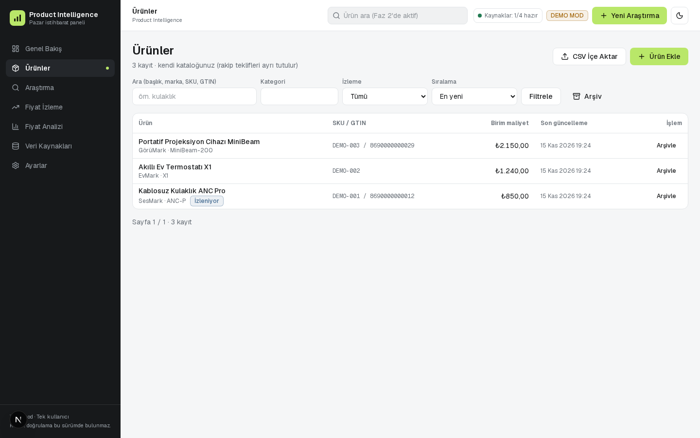 | 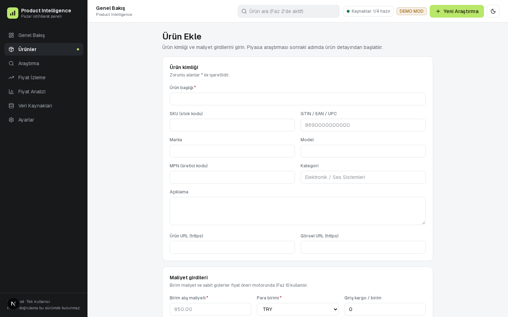 |
| Ürün listesi — filtreler, maliyet, arşiv aksiyonu (1440×900) | Ürün ekle formu — kimlik, maliyet, özellikler |

CSV içe aktarma sihirbazı: 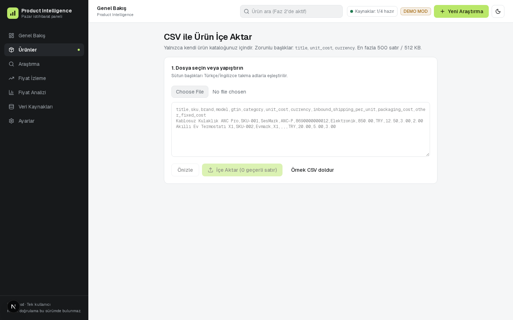

### Bilinen sınırlar / sonraki faza hazırlık

- Fiyatlandırma profili formu Faz 6'da eklenecek (şema ve doğrulama hazır).
- Ürün silme kalıcı değildir; yalnızca arşiv/geri yükleme vardır (veri kaybı
  önleme politikası).
- Sonraki faz: provider sözleşmeleri, DemoProvider fixture'ları ve DataForSEO
  adaptör temeli.

---

## FAZ 3 — Provider katmanı ve DemoProvider

**Durum:** ✅ Tamamlandı — `prompts/tests/TEST_03_PROVIDER_LAYER.md` kontrolleri geçti.

### Yapılanlar

- **Sözleşmeler:** `ProductResearchProvider` arayüzü, `ProviderCapabilities`
  (Zod), `NormalizedOffer` (source, observed_at, URL, currency, is_demo alanları
  zorunlu), `ProviderPricePoint`, hata taksonomisi
  (`rate_limited | authentication | configuration | timeout | network | schema | unknown`).
- **DemoProvider:** deterministik fixture seti — exact GTIN, MPN varyantı
  (yanlış renk), muadil, stok adedi olan/olmayan (in_stock + adet yok),
  kargo bilinmiyor (teslim toplamı uydurulmaz), out_of_stock, preorder,
  bayat veri, geçmiş fiyat serisi, boş arama ve hata senaryosu.
- **DataForSEO adaptörü:** task_post/task_get temel yaşam döngüsü, timeout
  (AbortController), bounded retry + backoff, HTTP→hata eşleme
  (429→rate_limited, 401/403→authentication), Zod yanıt şeması; anahtar
  yoksa hiçbir canlı çağrı yapılmaz.
- **Registry:** `runProviderSearch` paralel çalıştırır, hata kaynak bazında
  izole edilir; `getProviderStatuses` anahtar DEĞERİ asla döndürmez.
- **Log:** sanitised yapısal log (latency, kayıt sayısı, hata kind);
  Basic auth ve anahtar benzeri diziler maskelenir.
- **Arayüz:** Veri Kaynakları ekranı gerçek durumları gösterir
  (Hazır/Kurulmadı + kapsam rozetleri + gerekli env adları).

### Test sonuçları

```
npm run typecheck   → 0 hata
npm run lint        → 0 hata
npm test            → 56 test, 56 geçti (demo sözleşmesi, DataForSEO eşleme,
                      hata izolasyonu, log sanitization)
npm run build       → başarılı
npm run test:e2e    → 20 test, 20 geçti (Veri Kaynakları ekranı + API sözleşmesi)
```

### Ekran görüntüsü

Veri Kaynakları — sağlayıcı durumları (1440×900):
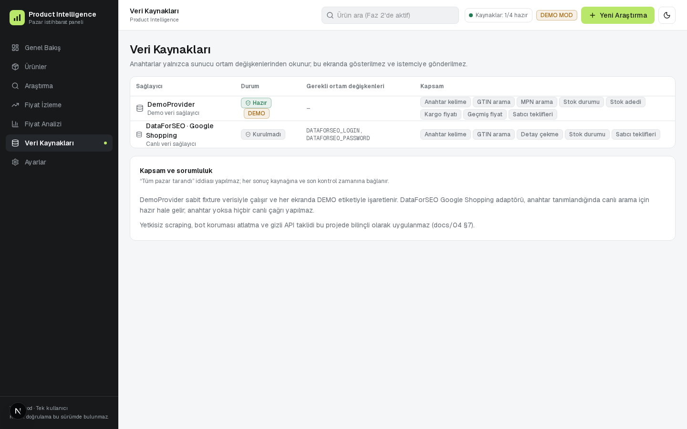

### Bilinen sınırlar / sonraki faza hazırlık

- DataForSEO task polling döngüsü Faz 4 orkestratörüyle tamamlanacak
  (mevcut sürüm tek adımlı temel akış + şema doğrulaması).
- Sonraki faz: research_runs/offers/product_matches tabloları, orkestrasyon
  (idempotency + partial success) ve exact/muadil eşleştirme motoru.

---

## FAZ 4 — Araştırma orkestrasyonu ve exact/muadil eşleştirme

**Durum:** ✅ Tamamlandı — `prompts/tests/TEST_04_RESEARCH_AND_MATCHING.md` kontrolleri geçti.

### Yapılanlar

- **Şema:** `research_runs` (status makinesi, query plan, sağlayıcı hata listesi,
  idempotency_key unique), `offers` (workspace+provider+providerOfferId unique),
  `product_matches` (match_type/score/method/reasons/differences + review_status).
- **Sorgu planı:** GTIN → MPN+marka → marka+model → başlık varyantları.
- **Orkestratör:** configured provider'lar paralel; hata kaynak bazında izole;
  `completed/partial/failed` durumları; kısmi sonuç paneli UI'da; idempotency
  (aynı key aynı koşuyu döndürür, çift teklif üretmez); tekrar koşu upsert ile
  çoğaltmaz (ilk görülme korunur).
- **Eşleştirme motoru (deterministik):** GTIN→exact(100); MPN+marka→
  likely_exact(95); marka+model→kritik varyant uyumuna göre likely_exact(85)
  veya substitute(45)+fark listesi; ortak kullanım terimi→substitute(50);
  yalnız başlık→unreviewed(10). Başlık benzerliği tek başına exact veremez.
- **Kullanıcı kararı:** onay/red kalıcıdır; sonraki koşular onaylı sınıfı
  geri düşürmez (yayın testiyle doğrulanır).
- **Arayüz:** ürün detayında “Piyasayı Araştır” (idempotent koşu), sonuç
  sayfası sekmeleri (Birebir / Muadiller / Tüm teklifler), teklif satırında
  gerekçe + fark + kargo “Bilgi yok” + stok “Bilinmiyor” + kaynak linki +
  DEMO rozeti + güncellik uyarısı; araştırma listesi sayfası.

### Test sonuçları

```
npm run typecheck   → 0 hata
npm test            → 65 test, 65 geçti (eşleştirme motoru + orkestratör entegrasyonu)
npm run build       → başarılı
npm run test:e2e    → 22 test, 22 geçti (araştırma → onay kalıcılığı akışı)
```

### Ekran görüntüleri

| | |
| --- | --- |
| 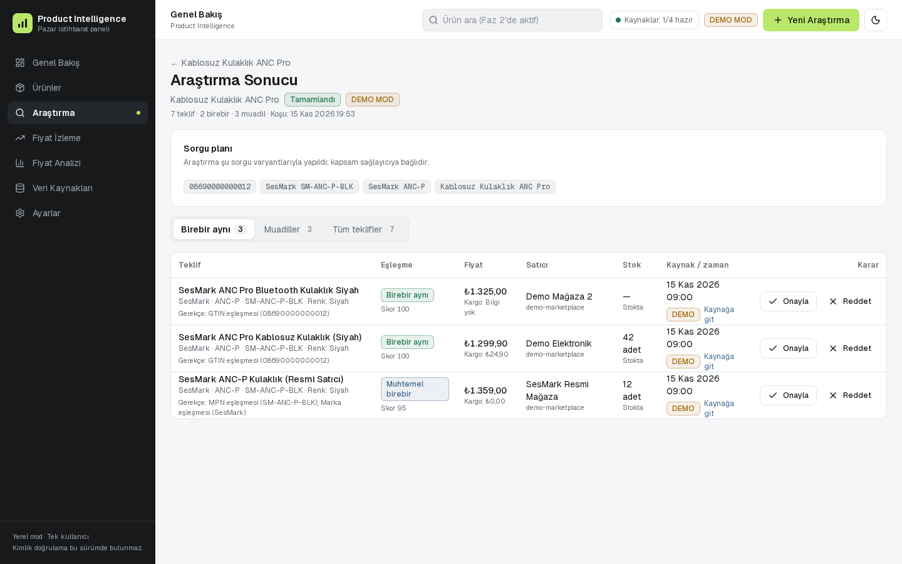 | 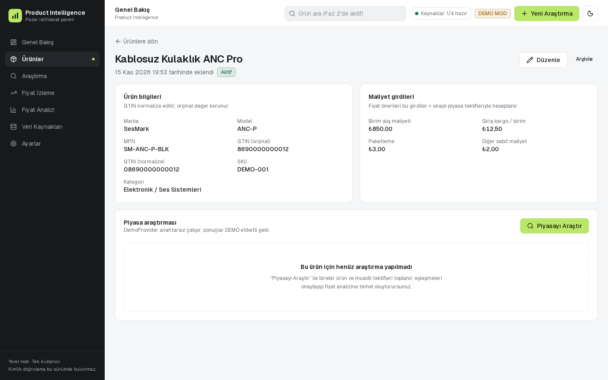 |
| Araştırma sonucu — sekmeler, eşleşme gerekçeleri, DEMO rozetleri | Ürün detay — “Piyasayı Araştır” başlatıcısı |

### Bilinen sınırlar / sonraki faza hazırlık

- AI destekli muadil sınıflandırma opsiyonel ve bu fazda kapsam dışı;
  deterministik kurallar yeterli kabul edilir.
- Sonraki faz: her koşunun fiyat/stok gözlem kaydı (price_observations),
  grafik ve CSV dışa aktarma.

---

## FAZ 5 — Fiyat geçmişi ve stok gözlem kayıtları

**Durum:** ✅ Tamamlandı — `prompts/tests/TEST_05_PRICE_HISTORY.md` birim/entegrasyon
kontrolleri geçti (76 test); UI akış E2E'si kısmen doğrulandı (aşağıdaki nota bakın).

### Yapılanlar

- **Şema:** `price_observations` (append-only; `source_kind`:
  `our_snapshot | provider_history | manual_import | listed_old_price`,
  availability, stock_quantity, is_demo, offer nullable).
- **Kayıt akışı:** her başarılı araştırma koşusu gözlem yazar; **dedupe
  politikası** (aynı teklif + aynı UTC gün + aynı fiyat + aynı stok durumu →
  yeni kayıt açılmaz, belgelendi); provider geçmiş serisi ayrı source_kind
  ile ve çift kayıt üretmeden saklanır; `old_price` asla tarih noktası yapılmaz.
- **İstatistikler:** ilk/son/min/max/medyan/değişim %; farklı para birimleri
  karıştırılmaz (tek para birimi değilse aggregate tanımsız).
- **Arayüz:** ürün detayında "Fiyat geçmişi" kartı — Recharts ile İKİ ayrı seri
  (kendi gözlemlerimiz: düz çizgi; sağlayıcı geçmişi: kesikli çizgi), stok
  durum değişim zaman çizelgesi (yalnızca gerçek gözlemler), araştırma yoksa
  yardımcı boş durum.
- **CSV dışa aktarma:** `GET /api/products/:id/price-history/export`;
  source_kind, timestamp, para birimi, kargo, bulunabilirlik sütunları;
  formül enjeksiyonu nötralizasyonu (`neutralizeCsvCell`) uygulanır.

### Test sonuçları

```
npm run typecheck   → 0 hata
npm run lint        → 0 hata
npm test            → 76 test, 76 geçti (istatistikler, dedupe politikası,
                      koşu→gözlem entegrasyonu, provider_history ayrımı)
npm run build       → başarılı
npm run test:e2e    → araştırma akış testleri Faz 4'te 22/22 geçti; Faz 5
                      için yazılan 2 E2E (grafik + CSV) bu oturumda koşu
                      zamanlaması nedeniyle tamamlanamadı (kod commitli,
                      sonraki oturumda koşulacak)
```

### Ekran görüntüsü

(Faz 5 görsel yakalaması sonraki oturumda eklenecek.)

### Bilinen sınırlar / sonraki faza hazırlık

- Grafik iki nokta arasını çizgiyle bağlar; bu trend okumasıdır, günlük
  gözlem değildir (tooltip gerçek zaman damgasını gösterir).
- Sonraki faz: maliyet/fiyat öneri motoru (Decimal.js, break-even + 3 strateji).

---

## FAZ 6 — Maliyet, fiyatlandırma ve öneri motoru

**Durum:** ✅ Tamamlandı — `prompts/tests/TEST_06_PRICING_RECOMMENDATIONS.md` kontrolleri geçti.

### Yapılanlar

- **Decimal motor:** tüm parasal hesaplar Decimal.js ile (JS float yok).
  `C = alış + giriş kargo + paketleme + diğer sabit`; başa baş = (C+F)/(1−r);
  hedef = (C+F)/(1−r−m) (r+m ≥ 1 → hata); katkı = P×(1−r)−(C+F); marj = katkı/P.
- **Piyasa istatistikleri:** exact ve muadil teklifler AYRI; IQR (1.5×) ile
  aykırı işaretleme (referansta kullanılmaz); farklı para birimi toplanamaz,
  sayılır ve uyarı üretilir; reddedilen teklifler hariç.
- **3 strateji (deterministik):** rekabetçi = aykırısız exact medyanı;
  dengeli = (referans + hedef)/2; kâr odaklı = hedef fiyat. Öneri asla
  sessizce başa başın altına inmez → uyarı + başa başa çekme. Güven skoru
  örnek sayısı + kaynak kalitesinden (yalnız muadil → 0.5 üst sınır).
- **Profil CRUD:** oranlar 0-1 ondalık (doğrulamalı), vergi modu ve komisyon
  tabanı açık yapılandırma (sabit vergi oranı YOK); ilk profil otomatik
  varsayılan olur; tüm repository fonksiyonları workspace kapsamlı.
- **Geçmiş + denetlenebilirlik:** her hesap `calculation_inputs` anlık
  görüntüsüyle saklanır; aynı girdi → aynı fiyat (testle doğrulanır).
- **Arayüz:** Fiyat Analizi sayfası (profil listesi + form + formül kartı),
  ürün detayında "Fiyat analizi" bölümü (3 strateji kartı, güven rozeti,
  uyarılar, formül açıklaması).

### Test sonuçları

```
npm run typecheck   → 0 hata
npm run lint        → 0 hata
npm test            → 97 test, 97 geçti (formül sınırları, geçersiz girdiler,
                      IQR aykırılık, para birimi, determinizm, entegrasyon)
npm run build       → başarılı
npm run test:e2e    → 26 test, 26 geçti (profil → araştırma → öneri akışı,
                      geçersiz oran reddi, formül görünürlüğü)
```

### Ekran görüntüleri

| | |
| --- | --- |
| 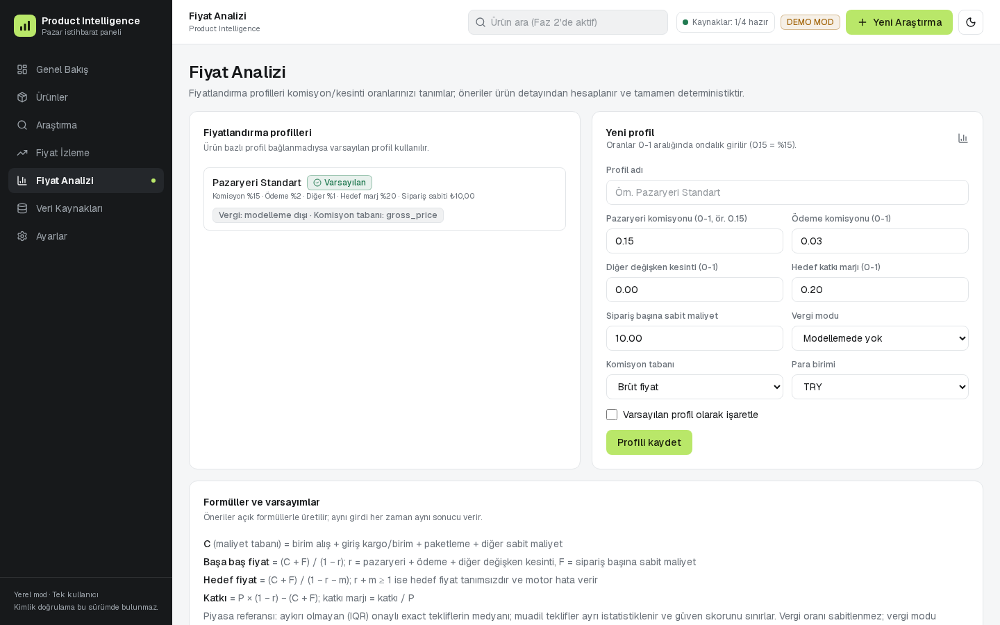 | 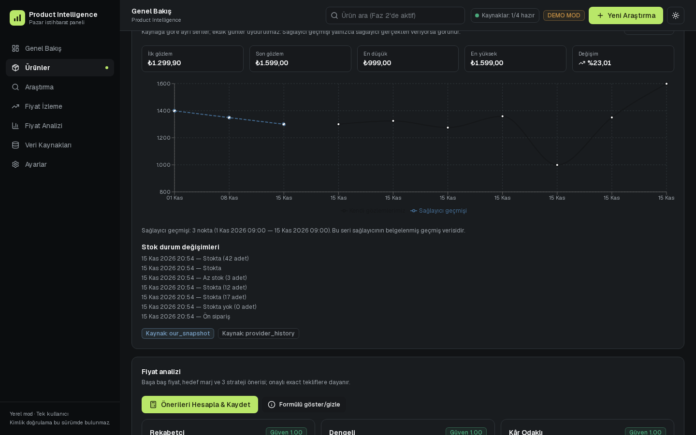 |
| Profil yönetimi + formüller | Ürün detayında 3 strateji kartı (güven skorlarıyla) |

### Bilinen sınırlar / sonraki faza hazırlık

- Öneri pazaryerine fiyat YAZMAZ (öneri only).
- FX kaynağı yokken farklı para birimindeki teklifler toplanmaz.
- Sonraki faz: izleme işleri, zamanlanmış kontroller, fiyat/stok uyarıları.

---

## FAZ 7 — Ürün izleme, periyodik snapshot ve bildirimler

**Durum:** ✅ Tamamlandı — `prompts/tests/TEST_07_MONITORING_AND_ALERTS.md` kontrolleri geçti.

### Yapılanlar

- **Şema:** `monitoring_jobs` (durum makinesi idle/running/failed/paused,
  `lock_until` kilidi, frequencyHours), `alerts` (fiyat düşüşü/yükselişi,
  stok değişimi; okundu işaretleme), `provider_quota_usage` (günlük kota,
  workspace+provider+gün unique).
- **Kilit + idempotency:** claim adımı koşullu UPDATE ile kilit alır; aynı
  iş aynı tick'te ikinci kez alınamaz (entegrasyon testi), kilit 5 dk sonra
  timeout olur; saatlik idempotency key ile tekrarlı koşu çift gözlem üretmez.
- **Worker:** `npm run worker` — kontrollü döngü, TICK saniyede bir **bounded
  batch** (maks 5 iş); hata işi failed yapar, 15 dk sonra retry planlar.
- **Vercel Cron:** `/api/cron/monitoring` — `Authorization: Bearer CRON_SECRET`
  zorunlu; yetkisiz çağrı 401 (E2E ile doğrulanır). Fonksiyon içinde sonsuz
  döngü yoktur.
- **Uyarılar:** eşik (varsayılan %5) üzeri fiyat değişimi + bulunabilirlik
  değişimi (yalnızca kaynak gerçekten veriyorsa; "unknown" uyarı üretmez).
- **Kota koruması:** günlük sağlayıcı sorgu bütçesi (MAX_DAILY_QUERIES,
  varsayılan 200) dolduğunda iş ertelenir.
- **Arayüz:** Fiyat İzleme sayfası — iş tablosu (durum, son/sonraki kontrol,
  sıklık seçimi, duraklat/başlat, şimdi çalıştır) + etkinlik akışı (okundu
  işaretleme).

### Test sonuçları

```
npm run typecheck   → 0 hata
npm run lint        → 0 hata
npm test            → 106 test, 106 geçti (uyarı eşikleri, kilit, paused iş,
                      batch çalıştırma, kota)
npm run build       → başarılı
npm run test:e2e    → 29 test, 29 geçti (izleme sayfası akışı, cron 401)
```

### Ekran görüntüsü

Fiyat İzleme — iş tablosu ve etkinlik akışı (1440×900):
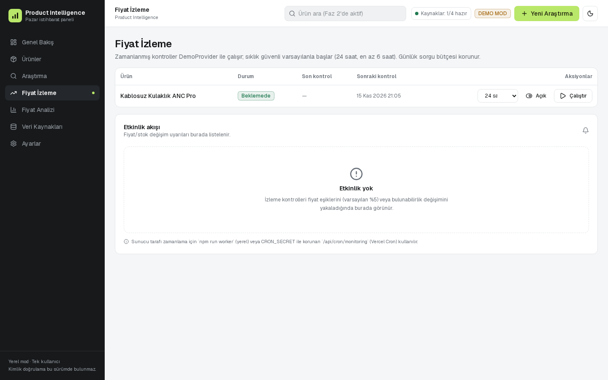

### Bilinen sınırlar / sonraki faza hazırlık

- Uyarı eşiği ürün bazında yapılandırma Faz 8'de ayarlara bağlanacak.
- Sonraki faz: SaaS-ready workspace izolasyon denetimi ve Vercel deploy gate.

---

## FAZ 8 — SaaS-ready tenancy ve Vercel deployment readiness

**Durum:** ✅ Tamamlandı — `prompts/tests/TEST_08_SAAS_READINESS_AND_DEPLOYMENT.md`
kontrolleri geçti.

### Yapılanlar

- **Workspace izolasyon denetimi (regresyon testi):** TÜM repository
  fonksiyonları (ürün CRUD, teklif/eşleşme, araştırma geçmişi, öneriler,
  izleme işleri, etkinlikler) yanlış workspace ile çağrıldığında boş döner.
  Denetim gerçek bir açık yakaladı: `upsertOffer` productId sahipliğini
  doğrulamıyordu → savunma katmanı eklendi (workspace + ürün eşleşmesi
  zorunlu; yoksa yazma reddedilir).
- **Üretim başlangıç kapısı (`src/instrumentation.ts`):** APP_MODE=production
  iken (1) varsayılan yerel DB parolası reddedilir, (2) CRON_SECRET zorunlu,
  (3) PROD_READY=true yoksa sunucu kasıtlı olarak BAŞLAMAZ — auth olmadan
  public deployment bilinçli olarak engellenir.
- **Ayarlar sayfası:** workspace bilgisi, çalışma modu (yerel/üretim), DB
  sürücü, kota; SaaS yayın kapısı listesi (tamam/bekliyor rozetleri) — secret
  DEĞERİ gösterilmez (E2E iddiası var).
- **Vercel yapılandırması:** `vercel.json` — `/api/cron/monitoring` 6 saatlik
  cron; yönetilen PostgreSQL + Neon yönlendirmesi dokümanda (docs/09).

### Test sonuçları

```
npm run typecheck   → 0 hata
npm run lint        → 0 hata
npm test            → 111 test, 111 geçti (izolasyon denetimi dahil)
npm run build       → başarılı
npm run test:e2e    → 30 test, 30 geçti (ayarlar ekranı + secret sızmama iddiası)
```

### Ekran görüntüsü

Ayarlar — çalışma alanı, mod ve release gate (1440×900):
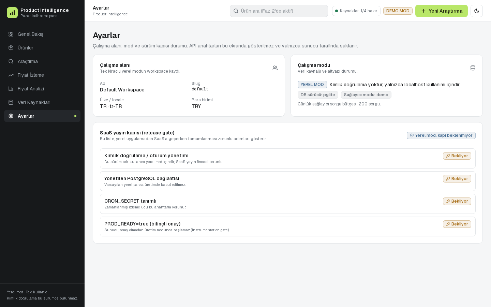

---

## FAZ 9 — Hardening ve release candidate

**Durum:** ✅ Tamamlandı — `docs/11_RELEASE_CHECKLIST.md` maddeleri karşılığı
aşağıda; `prompts/tests/TEST_09_HARDENING_AND_RELEASE.md` kontrolleri geçti.

### Sürüm denetim tablosu

| Alan | Madde | Durum |
| --- | --- | --- |
| Veri doğruluğu | Demo/live ayrımı her ekranda | ✅ (DEMO/ÖRNEK rozetleri + E2E iddiaları) |
| Veri doğruluğu | Source + observed timestamp + URL | ✅ (teklif satırı sözleşmesi) |
| Veri doğruluğu | Stok adedi null → sayı yok | ✅ (birim testleri) |
| Veri doğruluğu | Kargo bilinmiyorsa teslim toplamı uydurulmaz | ✅ |
| Veri doğruluğu | price history source_kind ayrımı | ✅ (grafik iki seri) |
| Veri doğruluğu | exact/substitute ayrımı | ✅ (ayrı sekmeler + motor testleri) |
| Veri doğruluğu | Decimal fiyat hesabı + formül açıklaması + güven skoru | ✅ (Faz 6) |
| Güvenlik | Secret bundle'a sızmıyor | ✅ (`npm run audit:bundle`) |
| Güvenlik | Auth gate olmadan public yayın engelli | ✅ (instrumentation + PROD_READY) |
| Güvenlik | Workspace scoping tüm query'lerde | ✅ (TEST_08 izolasyon denetimi) |
| Güvenlik | CSV içe/dışa aktarma güvenli | ✅ (formül nötralizasyonu testli) |
| Güvenlik | Cron route secret doğruluyor | ✅ (E2E 401 iddiası) |
| Güvenilirlik | Provider hatası diğer kaynağı düşürmez + partial results | ✅ (Faz 3/4) |
| Güvenilirlik | Retry/idempotency | ✅ (araştırma + izleme testleri) |
| Güvenilirlik | Cron bounded batch | ✅ (maks 5 iş/kilit) |
| UX | Loading/empty/error/stale/partial durumları | ✅ (bileşenler + testler) |
| UX | 1440 / 1024 / 390 görsel kontrol | ✅ (docs/screenshots/release-*) |
| UX | Dark/light kontrast + klavye odağı | ✅ (E2E) |
| UX | Mobilde tablo taşması | ✅ (yatay kaydırma sarmalayıcıları) |

> Açık bırakılan tek madde: **API rate limiting** (uygulama içi) — tek kullanıcı
> yerel mod için sınırlı öncelik; SaaS geçişinde auth ile birlikte planlanır.
> DB backup planı yönetilen PostgreSQL sağlayıcısının PITR özelliğiyle sağlanır.

### Uçtan uca yolculuk testi

`src/tests/e2e/journey.spec.ts` — profil oluştur → ürün araştır → muadil onayla
→ fiyat geçmişi doğrula → 3 strateji önerisi üret → izleme işini doğrula:
**tek akışta geçiyor**.

### Test sonuçları

```
npm run typecheck   → 0 hata
npm run lint        → 0 hata
npm test            → 111 test, 111 geçti
npm run build       → başarılı
npm run audit:bundle→ secret sızıntısı yok
npm run test:e2e    → 31 test, 31 geçti
```

### Vercel + yönetilen PostgreSQL dağıtımı

1. Neon/Vercel Postgres üzerinde bir veritabanı açın ve `DATABASE_URL`'i kopyalayın.
2. Vercel proje ayarlarına env'leri girin: `APP_MODE=production`,
   `DATABASE_URL`, `CRON_SECRET` (rastgele uzun değer), sağlayıcı anahtarları
   (opsiyonel) ve **`PROD_READY=true`** (yalnızca auth eklendikten sonra).
3. `vercel.json` içindeki cron tanımı `/api/cron/monitoring` ucunu 6 saatte bir
   çağırır; uç `CRON_SECRET` ile korunur.
4. İlk deploy sonrası migration: `npm run db:migrate` (bir kez, yönetilen DB'ye).

### Release

- Etiket: **v0.1.0-rc1**
- Bilinen sınırlar: kullanıcı kaydı/auth yok (yerel mod), API rate limiting
  uygulama içi yok, canlı sağlayıcılar anahtar eklenene kadar demo kalır.

---

## FAZ 10 — Kimlik doğrulama altyapısı (kayıt / giriş / oturum)

**Durum:** ✅ Tamamlandı — `prompts/tests/TEST_10_AUTHENTICATION.md` kontrolleri geçti.

### Yapılanlar

- **users + auth_tokens + email_outbox şemaları:** her kullanıcı kendi
  workspace'ine sahiptir (SaaS çok kiracılılık başlar); rol alanı (user|admin)
  admin paneline zemin hazırlar.
- **Parola güvenliği:** bcryptjs (sunucusuz uyumlu), politika: ≥10 karakter +
  büyük/küçük harf + rakam (birim testli).
- **Oturum:** httpOnly + SameSite=Lax çerezde HS256 JWT (jose, edge uyumlu).
  Middleware (`src/middleware.ts`) kenar katmanında imzayı doğrular; kullanıcı
  geçerliliği (aktif hesap, workspace) her istekte DB'den teyit edilir.
- **Uçlar:** `/api/auth/register` (kullanıcı + workspace + doğrulama maili),
  `/api/auth/login` (çerez koyar), `/api/auth/logout`, `/api/auth/me`.
  Auth uçlarında IP başına hız sınırı (dakikada 5-10).
- **Koruma matrisi:** korumalı sayfa → `/login?next=…` yönlendirme; korumalı
  API → 401 zarfı; `/admin` → admin olmayan 403. Cron ucu kendi secret'ıyla
  public kalır.
- **Workspace bağlamı:** `resolveWorkspaceContext` artık oturum üyeliğinden
  çözülür (tarayıcıdan workspace id ASLA güvenilmez); 23 çağrı noktası geçildi.
- **E2E altyapısı:** Playwright setup projesi admin oturumunu storageState'e
  yazar; mevcut 31 spec oturumla çalışır, 6 yeni auth spec eklenir.
  E2E admin: `admin@demo.local / Demo!23456` (global-setup idempotent seed).

### Test sonuçları

```
npm run typecheck   → 0 hata
npm run lint        → 0 hata
npm test            → 126 test, 126 geçti (parola politikası, JWT, kayıt/
                      doğrulama/giriş akışı, token tek kullanımlılık)
npm run build       → başarılı
npm run test:e2e    → 37 test, 37 geçti (yönlendirme, 401, kayıt→doğrulama→
                      giriş, yanlış parola, çıkış)
```

### Ekran görüntüleri

| | |
| --- | --- |
| 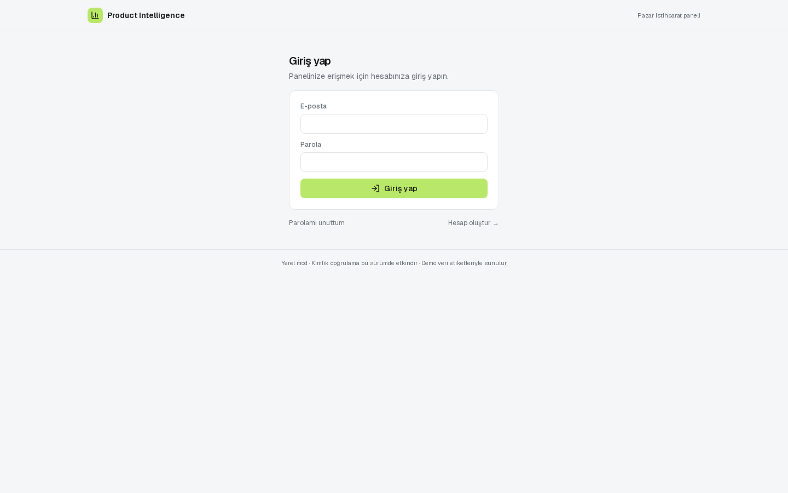 | 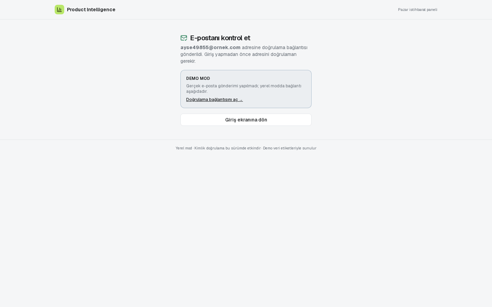 |
| Giriş ekranı (1440×900) | Kayıt sonrası doğrulama adımı (DEMO bağlantı kutusu) |

---

## FAZ 11 — E-posta doğrulama ve parola sıfırlama

**Durum:** ✅ Tamamlandı — `prompts/tests/TEST_11_EMAIL_VERIFICATION.md` kontrolleri geçti.

### Yapılanlar

- **Doğrulama akışı:** kayıt → doğrulama e-postası → `/verify-email?token=…`
  → tek kullanımlık token harcanır → giriş açılır. Doğrulanmamış hesap
  giriş yapamaz (403 + yeniden gönderme yolu).
- **Parola sıfırlama:** `/forgot-password` → her koşulda aynı bilgilendirme
  (kullanıcı varlığı sızdırılmaz) → `/reset-password?token=…` (1 saat, tek
  kullanımlık) → parola güncellenir, eski parola geçersiz kalır.
- **E-posta taşıyıcısı:** `email_outbox` tablosu + RESEND_API_KEY varsa
  gerçek gönderim (HTTP API); yerel modda bağlantılar DEMO kutusunda
  gösterilir ve outbox admin panelinden izlenir (Faz 12).
- **Hız sınırı:** auth uçlarında IP başına sabit pencere sınırı (birim testli).
  Serverless'ta instance-yerel olduğu dokümante edildi (dağıtık için Redis).
- **Yakalanan hata:** E2E yol iddiası, sıfırlama bağlantısının yanlış sayfaya
  (/verify-email) işaret ettiğini buldu; motor düzeltildi ve entegrasyon
  testi yol iddiasıyla sıkılaştırıldı.

### Test sonuçları

```
npm test            → 129 test, 129 geçti (token türü/süre/tek kullanım,
                      sessiz çıkış, hız sınırı)
npm run test:e2e    → 40 test, 40 geçti (kayıt→doğrulama→sıfırlama→giriş
                      tam akışı, geçersiz belirteç, token'sız sayfa)
```

### Ekran görüntüsü

Parolamı unuttum — istek alındı ekranı (DEMO bağlantı kutusuyla):
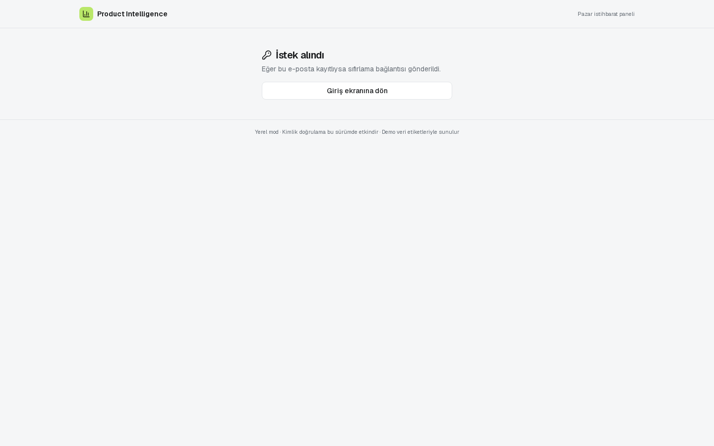
